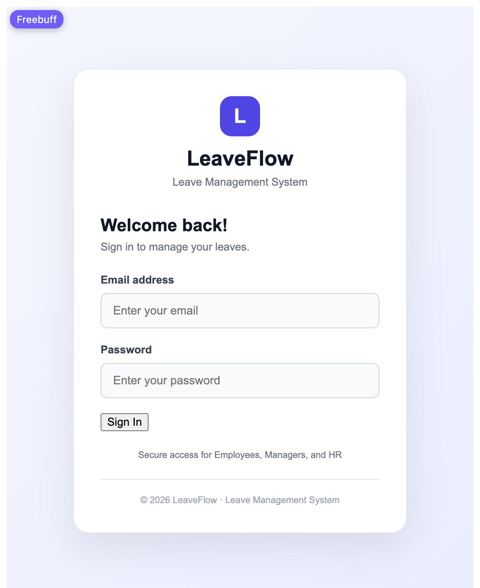
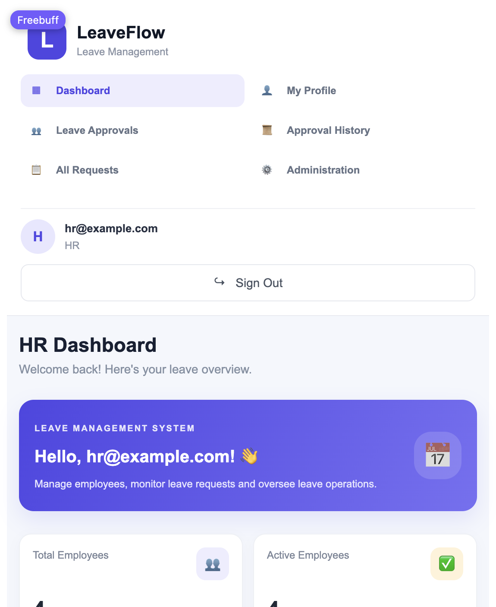
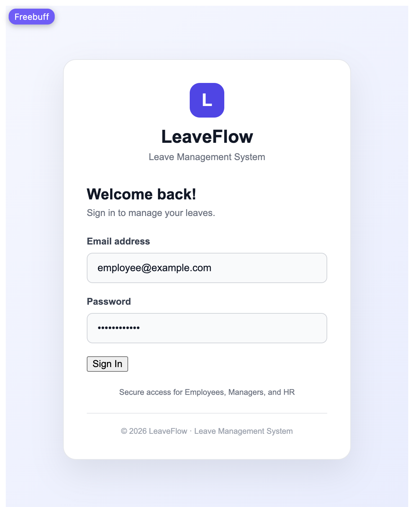
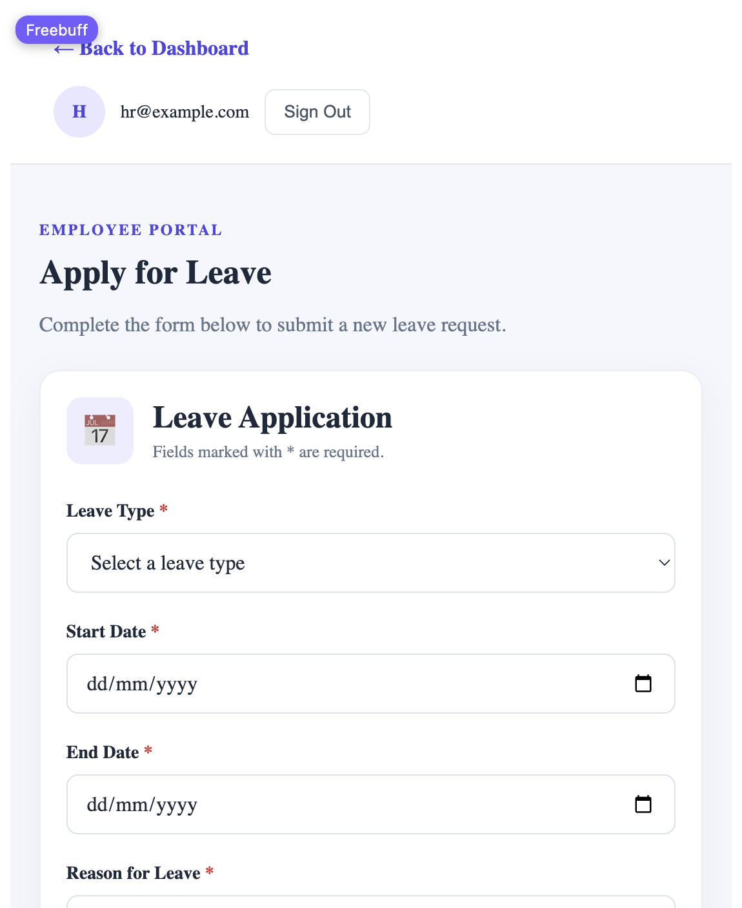
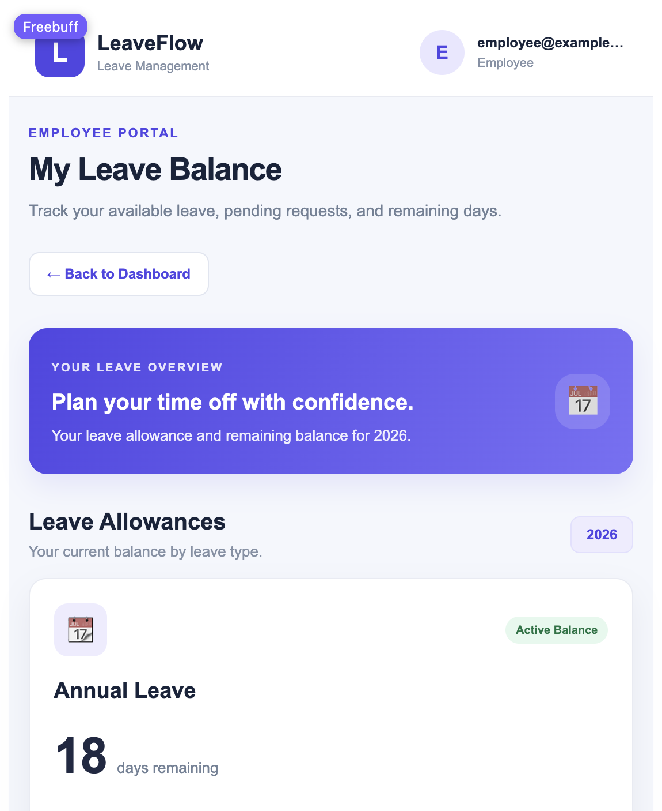
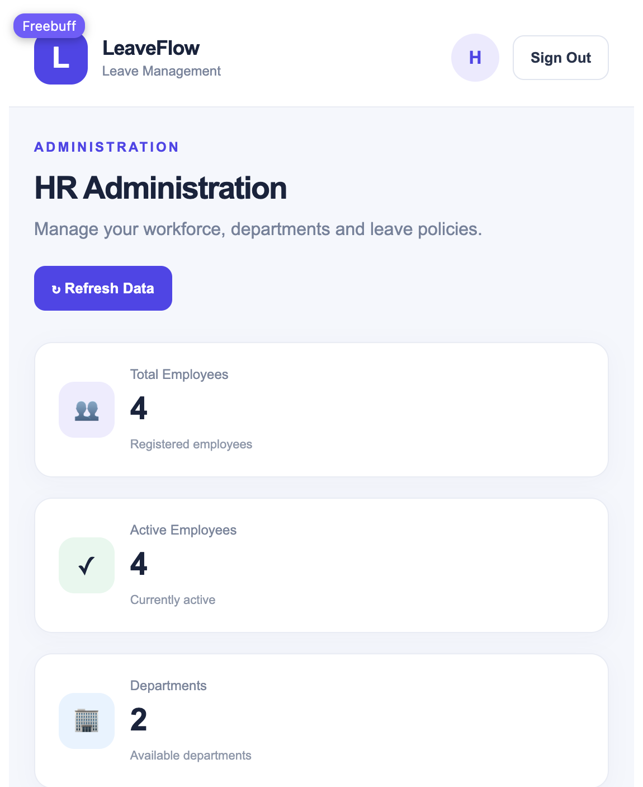
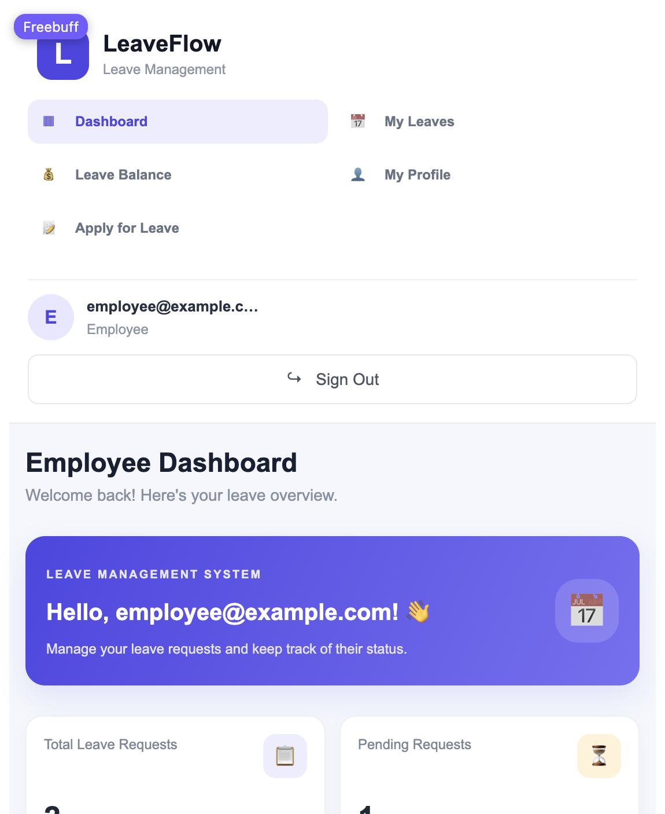
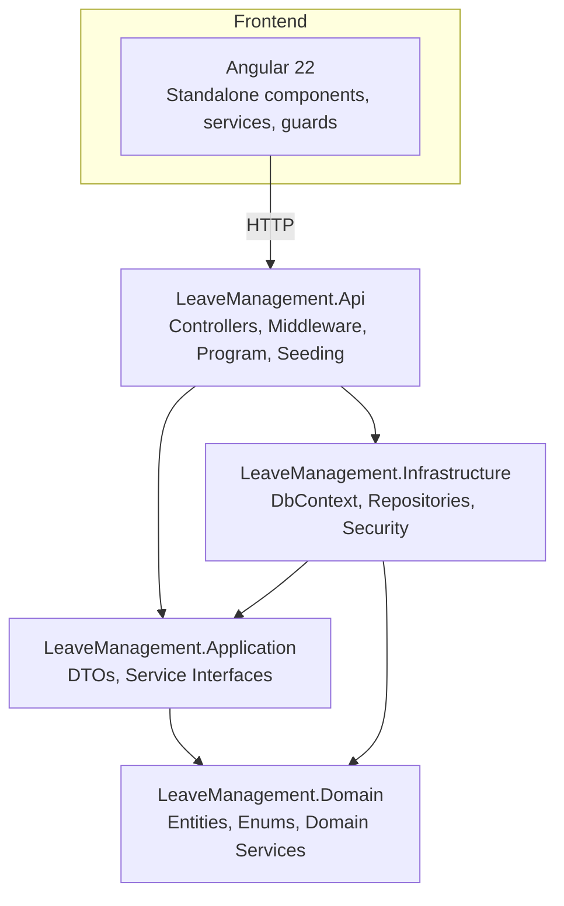

# Leave Management System

[](https://dotnet.microsoft.com/)
[](https://dotnet.microsoft.com/technologies/asp-net-core)
[](https://learn.microsoft.com/ef/core/)
[](https://www.microsoft.com/sql-server/)
[](https://angular.io/)
[](https://www.typescriptlang.org/)
[](https://jasontatal.github.io/clean-architecture/)

A full-stack leave management application for employees, managers, and HR administrators. Employees request leave and view their balances, managers approve or reject requests from their team, and HR manages the workforce, departments, leave policies, and company calendar.

## Project Overview

The system models a small workplace leave process end to end:

- **Employees** apply for leave, cancel pending requests, and check how many days remain in each leave type for the current year.
- **Managers** review pending requests from direct reports, approve or reject them with a comment, and review their approval history.
- **HR administrators** handle the full administration surface: employee accounts, departments, leave types, and holidays, along with a consolidated view of all leave requests across the company.

The backend is a REST API built with ASP.NET Core. The frontend is a standalone Angular 22 application that consumes that API over HTTP.

## Key Features

### Employee

- Sign in with an account tied to their employee record.
- Submit new leave requests for themselves.
- View their own leave request history.
- Cancel pending requests, and cancel approved requests that have not yet started.
- View current-year leave balances across all leave types.
- View their own profile details.

### Manager

- Review pending leave requests from direct reports only.
- Approve or reject requests, with an optional decision comment.
- View approval history for the current year, with employee, department, leave type, and decision details.
- Create leave requests on behalf of direct reports.
- View the leave balances of direct reports.
- Access the same employee self-service pages as employees.

### HR / Administrator

- View a dashboard summary of total employees, active employees, departments, and active leave types.
- View all leave requests across the company, filtered by employee and status, with approve/reject actions.
- Manage employee accounts:
  - Create new employees with name, email, department, manager, and joining date.
  - Edit existing employees.
  - Activate or deactivate employees with confirmation prompts.
  - Search and paginate the employee directory.
- Manage departments:
  - Create departments.
  - Rename existing departments.
  - Retire departments that have no active employees assigned.
  - Duplicate department names are rejected.
- Manage leave policies:
  - Create leave types with annual allowance and manager-approval rules.
  - Edit existing leave types.
  - Activate or deactivate leave types, preserving history and balances.
  - Duplicate leave type names are rejected.
- Manage the holiday calendar:
  - Load holidays for a selected year.
  - Create, rename, and delete holidays.
  - Duplicate holiday dates are rejected.

### Authentication and Authorization

- JWT-based authentication.
- Every API endpoint requires authentication.
- Role-based access control across the API, with distinct permissions for `Employee`, `Manager`, and `HR`.
- Login failures return a clear 401 message instead of an unhandled server error.
- Frontend route guards keep each role on the pages they are allowed to use.

### Leave Management

- Leave requests store type, date range, total working days, reason, status, approver, decision time, and decision comment.
- Working days are counted by skipping weekends and company holidays.
- Leave balances are tracked per employee, per leave type, per year, with separate available and pending amounts.
- Leave types can require manager approval.
- Departments and leave types are soft-deleted where history and balances must be preserved. Holidays are hard-deleted.

### Dashboard and Reporting

- Role-aware dashboard that surfaces relevant summary information for HR, manager, and employee contexts.
- Approval history table for managers and HR.
- Consolidated all-requests view for HR.

## Screenshots

### Login



### HR Dashboard



### HR Administration


### Employee Dashboard



### Apply for Leave



### My Leaves


### Leave Balance



### Manager Approvals



### Approval History



### Employee Profile


## Technology Stack

| Layer | Technology |
|-------|------------|
| Backend framework | ASP.NET Core on .NET 10.0 |
| Frontend framework | Angular 22 with standalone components |
| Frontend language | TypeScript 6.0 |
| Database | SQL Server |
| ORM | Entity Framework Core 10.0.10 |
| Authentication | JWT Bearer tokens (`Microsoft.AspNetCore.Authentication.JwtBearer`) |
| API docs | OpenAPI / Swagger UI (development) |
| Password hashing | `System.Security.Cryptography.Pkcs` |
| Token generation | `System.IdentityModel.Tokens.Jwt` |
| Dependency injection | Built-in ASP.NET Core DI |
| Repositories | Repository pattern with a `UnitOfWork` for transactions |
| Architecture | Clean Architecture with separate Domain, Application, Infrastructure, and API layers |

### Development tools

- Angular CLI 22.1.8
- Vitest and jsdom for frontend unit tests
- EF Core tools for migrations
- .NET user secrets for development-only configuration

## Architecture

The backend follows Clean Architecture with four projects:

```
LeaveManagement.Domain          # Entities, enums, domain services
LeaveManagement.Application     # DTOs, service interfaces
LeaveManagement.Infrastructure  # EF Core DbContext, repositories, security implementations
LeaveManagement.Api             # Controllers, middleware, startup, seeding
```

### Layers

**API Layer** (`LeaveManagement.Api`)
- Controllers: `AuthController`, `EmployeeController`, `DepartmentController`, `LeaveTypeController`, `LeaveRequestController`, `LeaveApprovalController`, `LeaveBalanceController`, `HolidayController`.
- Global exception middleware that converts unhandled server errors into a consistent JSON response.
- CORS configured from configuration, with the Angular dev server as the default allowed origin.
- OpenAPI document generation and Swagger UI in development.

**Application Layer** (`LeaveManagement.Application`)
- Service interfaces in `Interfaces/Services`.
- DTOs for input and output shapes.
- No infrastructure dependencies.

**Domain Layer** (`LeaveManagement.Domain`)
- Entities: `Employee`, `Department`, `LeaveType`, `LeaveRequest`, `LeaveBalance`, `Holiday`, `ApplicationUser`.
- Enums: `Role`, `LeaveRequestStatus`.
- Domain service: `WorkingDayCalculator`.

**Infrastructure Layer** (`LeaveManagement.Infrastructure`)
- EF Core `AppDbContext` with fluent configurations.
- Repository implementations for each aggregate.
- `UnitOfWork` for transactional operations.
- JWT token service and password hasher implementations.
- Business clock abstraction so date-based rules use the configured business timezone.

### Dependency flow

- `Api` depends on `Application` and `Infrastructure`.
- `Infrastructure` depends on `Application` and `Domain`.
- `Application` depends on `Domain`.
- `Domain` has no dependencies on the other projects.



### Patterns

- **Repository pattern**: each aggregate has a repository interface in the Application project and an EF Core implementation in Infrastructure.
- **Unit of Work**: transactional scope for operations that span repositories.
- **Dependency injection**: services and repositories are registered in `Program.cs` and consumed through interfaces.
- **Service layer**: application logic lives in service interfaces; controllers are thin request/responses translators.

## Database Design

### Main entities

| Entity | Purpose |
|--------|---------|
| `Employee` | Employee profile: name, email, department, manager, joining date, active flag. |
| `Department` | Company department with name and active flag. |
| `LeaveType` | Leave policy: name, annual allowance, active flag, requires-manager-approval flag. |
| `LeaveRequest` | Individual leave request with employee, leave type, date range, total days, status, and decision metadata. |
| `LeaveBalance` | Yearly balance per employee and leave type. |
| `Holiday` | Company holiday date and name for a given year. |
| `ApplicationUser` | Login account linked to an employee, with username, password hash, and role. |

### Key relationships

- `Employee` → `Department` (many-to-one).
- `Employee` → `Employee` manager (self-reference).
- `LeaveRequest` → `Employee` and `LeaveType` (many-to-one).
- `LeaveBalance` → `Employee` and `LeaveType` (many-to-one).
- `ApplicationUser` → `Employee` (one-to-one by `EmployeeId`).

```mermaid
erDiagram
    Department ||--o{ Employee : "has employees"
    Employee ||--o{ LeaveRequest : "creates"
    Employee ||--o{ LeaveBalance : "has balances"
    Employee }o--o{ Employee : "reports to manager"
    LeaveType ||--o{ LeaveRequest : "used by"
    LeaveType ||--o{ LeaveBalance : "balanced per type"
    Employee ||--|| ApplicationUser : "has login account"
    Holiday ||--o{ Holiday } : "per year"
```

### EF Core migrations

Migrations are stored in `LeaveManagement.Infrastructure/Persistence/Migrations`:

- `20261028060052_InitialCreate`
- `20261102070330_RemoveRefreshTokenFeature`

### Database initialization

In development, the API seeds reference data and demo accounts on startup if they do not already exist:

- Departments: Engineering, Human Resources.
- Leave types: Annual Leave, Sick Leave, Casual Leave.
- Demo holidays for the configured demo year.
- Demo employees and their login accounts.
- Initial leave balances for each demo employee and active leave type.

Seeding is safe to run on every startup because each step checks for existing records first.

## Project Structure

```
LeaveManagement/
├── LeaveManagement.slnx
├── LeaveManagement.Api/
│   ├── Controllers/
│   │   ├── AuthController.cs
│   │   ├── DepartmentController.cs
│   │   ├── EmployeeController.cs
│   │   ├── HolidayController.cs
│   │   ├── LeaveApprovalController.cs
│   │   ├── LeaveBalanceController.cs
│   │   ├── LeaveRequestController.cs
│   │   └── LeaveTypeController.cs
│   ├── Middleware/
│   │   └── ExceptionHandlingMiddleware.cs
│   ├── Models/
│   │   └── LeaveDecisionDto.cs
│   ├── Program.cs
│   ├── appsettings.json
│   ├── appsettings.example.json
│   └── LeaveManagement.Api.csproj
├── LeaveManagement.Application/
│   ├── DTOs/
│   │   ├── Authentication/
│   │   ├── Employees/
│   │   └── Leave/
│   └── Interfaces/
│       ├── Repositories/
│       ├── Security/
│       └── Services/
├── LeaveManagement.Domain/
│   ├── Common/
│   ├── Employees/
│   ├── Identity/
│   ├── Leave/
│   └── Services/
├── LeaveManagement.Infrastructure/
│   ├── Persistence/
│   │   ├── Configurations/
│   │   ├── Migrations/
│   │   ├── AppDbContext.cs
│   │   └── UnitOfWork.cs
│   ├── Repositories/
│   ├── Security/
│   └── Time/
├── frontend/
│   ├── src/
│   │   ├── app/
│   │   │   ├── app.config.ts
│   │   │   ├── app.routes.ts
│   │   │   ├── app.ts
│   │   │   ├── app.html
│   │   │   ├── app.css
│   │   │   ├── guards/
│   │   │   │   └── role.guard.ts
│   │   │   ├── pages/
│   │   │   │   ├── apply-leave/
│   │   │   │   ├── approval-history/
│   │   │   │   ├── dashboard/
│   │   │   │   ├── employee-profile/
│   │   │   │   ├── hr-admin/
│   │   │   │   ├── hr-requests/
│   │   │   │   ├── leave-balance/
│   │   │   │   ├── leave-details/
│   │   │   │   ├── login/
│   │   │   │   ├── manager-approvals/
│   │   │   │   └── my-leaves/
│   │   │   └── services/
│   │   │       └── auth.service.ts
│   │   ├── environments/
│   │   ├── index.html
│   │   └── styles.css
│   ├── angular.json
│   ├── package.json
│   ├── tsconfig.json
│   └── tsconfig.app.json
└── docs/
    └── screenshots/
```

## Prerequisites

- [.NET 10.0 SDK](https://dotnet.microsoft.com/download/dotnet/10.0)
- [Node.js 22](https://nodejs.org/) and npm 11.x
- [SQL Server](https://www.microsoft.com/sql-server/) accessible from the backend

The project uses npm as the package manager for the Angular app.

## Installation and Setup

### 1. Clone the repository

```bash
git clone https://github.com/I-SKC/LeaveManagement.git
cd LeaveManagement
```

### 2. Set up SQL Server

Create a SQL Server instance and database that the backend can reach. The example configuration assumes SQL Server with SQL authentication:

```text
Server=localhost,14330;
Database=LeaveManagement;
User Id=sa;
Encrypt=True;
TrustServerCertificate=True;
```

Adjust the host, port, database name, and credentials to match your environment.

### 3. Configure the backend

Copy the example configuration into a local development file that is excluded from source control:

```bash
cp LeaveManagement.Api/appsettings.example.json LeaveManagement.Api/appsettings.Development.json
```

Then edit `LeaveManagement.Api/appsettings.Development.json` and set:

- `ConnectionStrings:DefaultConnection` to your SQL Server connection string.
- `Database:Password` via .NET user secrets or an environment variable.
- `Jwt:Key` to a strong secret of at least 32 bytes.
- `Jwt:Issuer` and `Jwt:Audience` if you want different values from the defaults.
- `Cors:AllowedOrigins` if your frontend runs on a different origin.

For development, the recommended approach is to keep secrets out of files entirely:

```bash
cd LeaveManagement.Api
dotnet user-secrets set "Database:Password" "<your-sql-password>"
dotnet user-secrets set "Seed:EmployeePassword" "<employee-password>"
dotnet user-secrets set "Seed:ManagerPassword" "<manager-password>"
dotnet user-secrets set "Seed:HrPassword" "<hr-password>"
cd ..
```

The default JWT key in `appsettings.json` is a development placeholder. Replace it with your own value in local configuration.

### 4. Restore .NET dependencies

```bash
dotnet restore LeaveManagement.slnx
```

### 5. Apply EF Core migrations

Update the database schema to the latest migration:

```bash
cd LeaveManagement.Infrastructure
dotnet ef database update
cd ..
```

If EF Core tools are not yet installed globally, install them first:

```bash
dotnet tool install --global dotnet-ef
```

### 6. Run the ASP.NET Core API

```bash
cd LeaveManagement.Api
ASPNETCORE_ENVIRONMENT=Development ASPNETCORE_URLS=http://localhost:5027 dotnet run
```

The API is available at `http://localhost:5027`. In development, Swagger UI is available at `/swagger`.

You can also build and run the published binary:

```bash
dotnet build LeaveManagement.slnx --nologo
cd LeaveManagement.Api
ASPNETCORE_ENVIRONMENT=Development ASPNETCORE_URLS=http://localhost:5027 \
  dotnet bin/Debug/net10.0/LeaveManagement.Api.dll
```

### 7. Install Angular dependencies

```bash
cd frontend
npm install
cd ..
```

### 8. Run the Angular frontend

For local development:

```bash
cd frontend
npm start
```

The frontend is available at `http://localhost:4200`.

The frontend points to `http://localhost:5027/api` by default. Update `frontend/src/environments/environment.ts` if the API runs on a different port.

### Build commands

```bash
# Backend
dotnet build LeaveManagement.slnx --nologo

# Frontend development build
cd frontend
ng build --configuration development

# Frontend production build
ng build
```

## Configuration and Security

### Configuration files

- `LeaveManagement.Api/appsettings.json` — baseline configuration excluded from secrets.
- Local overrides such as `appsettings.Development.json` are excluded from source control.
- Development secrets are stored with `dotnet user-secrets` or environment variables.

### What to configure

- **Database connection**: `ConnectionStrings:DefaultConnection` plus `Database:Password`.
- **JWT**: `Jwt:Key`, `Jwt:Issuer`, `Jwt:Audience`, and `Jwt:AccessTokenMinutes`.
- **CORS**: `Cors:AllowedOrigins`.

### Secrets

Never commit real passwords, JWT keys, or SQL credentials. The repository already excludes:

- `appsettings.Development.json`
- `appsettings.Local.json`
- `.env` files
- `secrets.json`
- `**/secrets.json`

Use user secrets or environment variables for local development.

### Authentication model

- Login sends a username and password to `POST /api/Auth/login`.
- Successful login returns a JWT access token, token type, expiry, username, and role.
- The token should be sent in the `Authorization` header as `Bearer <token>`.
- The frontend stores the token in browser storage for the session.

## API Documentation

The API is organized around resource controllers. All endpoints require authentication by default.

| Controller | Base route | Main responsibilities |
|------------|------------|------------------------|
| `AuthController` | `/api/Auth` | Login and employee registration. |
| `EmployeeController` | `/api/Employee` | List, get, create, update, activate, and deactivate employees. |
| `DepartmentController` | `/api/Department` | List, get, create, rename, and retire departments. |
| `LeaveTypeController` | `/api/LeaveType` | List, get, create, update, activate, and deactivate leave types. |
| `LeaveRequestController` | `/api/LeaveRequest` | Create and manage leave requests. |
| `LeaveApprovalController` | `/api/LeaveApproval` | Approve and reject requests, and view approval history. |
| `LeaveBalanceController` | `/api/LeaveBalance` | View leave balances for an employee and year. |
| `HolidayController` | `/api/Holiday` | List, get, create, update, and delete holidays. |

Role restrictions are enforced on the server. For example:

- Employee creation, updates, activation, and deactivation are HR-only.
- Department creation, renaming, and retirement are HR-only.
- Leave type creation, updates, activation, and deactivation are HR-only.
- Approval and rejection are Manager and HR only.
- Employees can create leave requests and view balances only for themselves.
- Managers can act on their direct reports.

Swagger UI is available in development at `/swagger` after the API starts.

## Demo Accounts

The seeded demo accounts are safe for documentation and local demos. Their exact passwords are stored in user secrets on the development machine and are not shown here.

The seeded accounts follow this pattern:

| Username | Role |
|----------|------|
| `hr@example.com` | HR |
| `manager@example.com` | Manager |
| `employee@example.com` | Employee |

To log in, use the email as the username and the password configured in your local user secrets or environment variables.

## Future Improvements

- Email notifications for leave request approvals, rejections, and cancellations.
- Calendar export for holidays and approved leave.
- Multi-year leave balance carry-forward rules.
- Audit logging for administrative changes.
- Pagination for the approval history view.
- Shared leave request comments and attachments.
- Role and permission customization beyond the current three-role model.
- Frontend containerization for simpler local and deployed runs.

## Author

**Iynaparthi Sri Krishna Chaitanya**

GitHub profile: https://github.com/I-SKC

